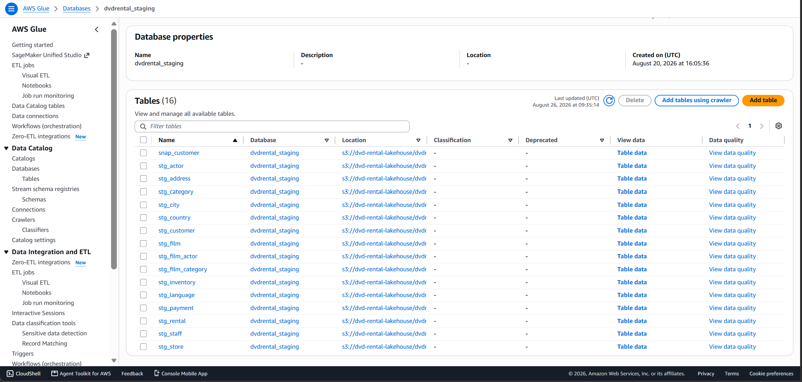

# Real-Time E-Commerce Analytics Lakehouse

> **Architected & Implemented by:** Dung Pham  
> **Repository:** [dvdrental_streaming_data](https://github.com/Dungpham0703/dvdrental_streaming_data)

## 1. Business Requirement

Operational databases (like PostgreSQL) are optimized for transactions but struggle with heavy analytical queries, causing performance degradation and loss of historical data (e.g., customer address changes).

**Goal:** Build a Real-Time Data Lakehouse to transform 15 normalized transactional tables into an optimized Star Schema. This enables Data Analysts to run high-performance OLAP queries and visualize business metrics in near real-time without impacting the source system's performance.

## 2. Data Modeling & Solution

To solve the analytical bottlenecks, the data was remodeled into a **Star Schema** following a Medallion Architecture (Bronze -> Silver -> Gold).

- **Slowly Changing Dimensions (SCD Type 2):** Applied to dimensions like `dim_customer` to preserve a complete history of changes (using `valid_from`, `valid_to`, `is_current`). This ensures accurate time-travel reporting and prevents historical data loss.
- **Fact & Dimension Tables:** Complex multi-table joins are simplified into centralized Fact tables (`fact_rental`, `fact_payment`) surrounded by descriptive Dimensions, making analytics straightforward and performant.

## 3. Tool Selection & Architecture

- **Debezium & Kafka:** Enables zero-impact Change Data Capture (CDC). It streams database changes asynchronously directly from transaction logs (WAL), avoiding heavy polling queries on the source DB.
- **Apache Hudi (Raw Layer):** Chosen for the Bronze (Raw) layer. Hudi's Merge-On-Read (MOR) format is highly optimized for continuous, low-latency streaming updates and upserts directly from Kafka.
  
- **Apache Iceberg (Staging/Mart Layers):** Chosen for Silver (Staging) and Gold (Mart) layers. Iceberg excels at large-scale OLAP analytical queries, schema evolution, and time-travel querying. It integrates seamlessly with dbt and AWS Athena for high-performance reading.
  
  
- **dbt (Data Build Tool):** Manages the transformation logic (SQL) from Raw to Staging to Mart. It handles the complex SCD Type 2 logic and automated data quality testing.
- **AWS Athena & Glue:** Provides serverless data cataloging and querying. Glue organizes the tables, making the S3 data instantly queryable via standard SQL in Athena.
  

## 4. Implementation Steps

1. **CDC Ingestion:** Debezium connects to PostgreSQL, captures row-level changes, and publishes them to Kafka topics.
2. **Raw/Bronze Layer:** Hudi Streamer consumes the Kafka topics and writes raw CDC events as Hudi MOR tables to AWS S3.
3. **Staging/Silver Layer:** dbt reads the Hudi tables, deduplicates records, handles tombstone deletes, and writes cleansed data into Iceberg tables.
4. **Data Mart/Gold Layer:** dbt transforms the Staging data into the final Star Schema (Facts and SCD Type 2 Dimensions) using Iceberg format, optimized for BI consumption.
5. **Analytics & BI:** AWS Athena queries the Iceberg Data Marts to power real-time dashboards in BI tools like Apache Superset or QuickSight.

## 5. Performance Review

- **Storage & Query Optimization:** Transitioning from Hudi (Raw) to Iceberg (Staging/Mart) with Parquet columnar compression drastically reduced S3 storage footprint and accelerated Athena query speeds.
- **Partitioning:** Fact tables are strategically partitioned (e.g., by date), which minimizes the data scanned during Athena queries and directly reduces AWS costs.
- **Zero Source Impact:** The log-based CDC approach completely offloaded analytical workloads from the production PostgreSQL database, ensuring 100% transactional uptime.
- **Reliability & Data Quality:** Automated dbt tests integrated into the pipeline guarantee that no duplicate or malformed data propagates to executive dashboards.
