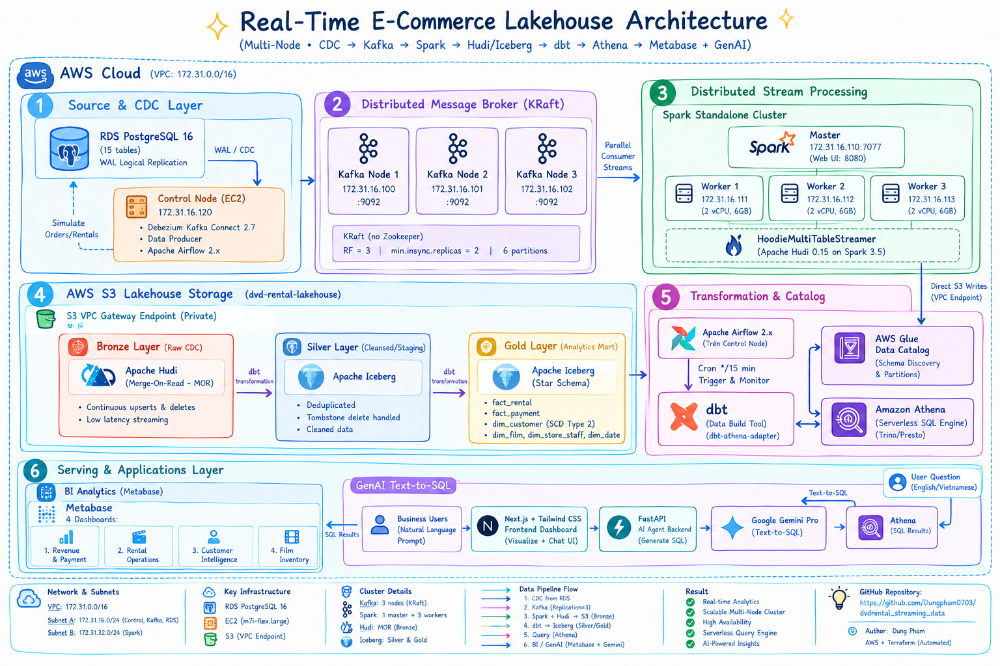
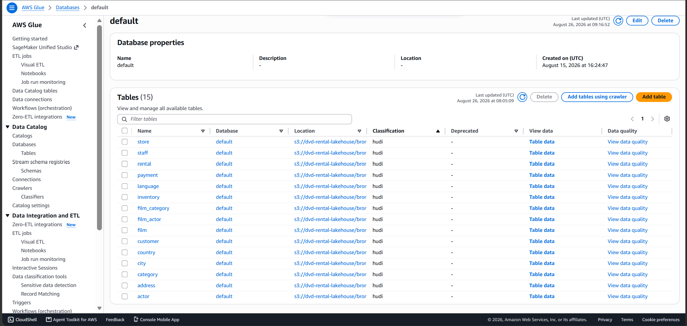
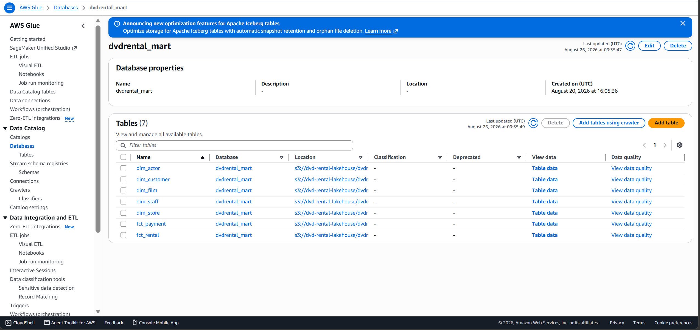
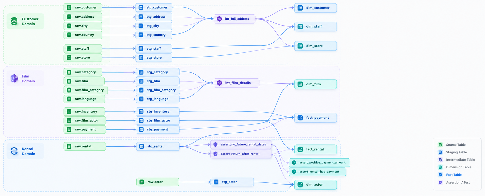
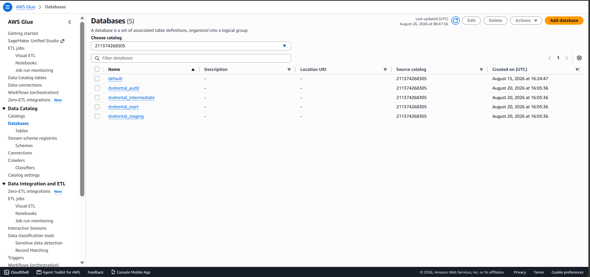

# Real-Time E-Commerce Analytics Lakehouse

> **Architected & Implemented by:** Dung Pham
> **Repository:** [dvdrental_streaming_data](https://github.com/Dungpham0703/dvdrental_streaming_data)



## 1. Business Requirement

Operational databases (like PostgreSQL) are optimized for transactions but struggle with heavy analytical queries, causing performance degradation and loss of historical data (e.g., customer address changes).

**Goal:** Build a Real-Time Data Lakehouse to transform 15 normalized transactional tables into an optimized Star Schema. This enables Data Analysts to run high-performance OLAP queries and visualize business metrics in near real-time without impacting the source system's performance.

## 2. Data Modeling & Solution

To solve the analytical bottlenecks, the data was remodeled into a **Star Schema** following a Medallion Architecture (Bronze -> Silver -> Gold).

```text
      ┌─────────────────────────┐             ┌─────────────────────────┐
      │      dim_customer       │             │        dim_date         │
      │ ----------------------- │             │ ----------------------- │
      │ (SCD Type 2 History)    │             │ (Time Context)          │
      │ PK: customer_key        │             │ PK: date_key            │
      │ valid_from, valid_to    │             │ day, month, year...     │
      └───────────┬─────────────┘             └─────────────┬───────────┘
                  │ 1:N                                     │ 1:N
                  │           ┌───────────────┐             │
                  └─────────► │  FACT TABLES  │ ◄───────────┘
                              │ ------------- │
                              │ fact_rental   │
                              │ fact_payment  │
                  ┌─────────► │               │ ◄───────────┐
                  │ 1:N       └───────────────┘       1:N   │
                  │                                         │
      ┌───────────┴─────────────┐             ┌─────────────┴───────────┐
      │        dim_film         │             │     dim_store_staff     │
      │ ----------------------- │             │ ----------------------- │
      │ (Movie Details)         │             │ (Location/Staff Info)   │
      │ PK: film_key            │             │ PK: store_key/staff_key │
      │ title, category, rating │             │ address, city, country  │
      └─────────────────────────┘             └─────────────────────────┘
```

- **Slowly Changing Dimensions (SCD Type 2):** Applied to dimensions like `dim_customer` to preserve a complete history of changes (using `valid_from`, `valid_to`, `is_current`). This ensures accurate time-travel reporting and prevents historical data loss.
- **Fact & Dimension Tables:** Complex multi-table joins are simplified into centralized Fact tables (`fact_rental`, `fact_payment`) surrounded by descriptive Dimensions, making analytics straightforward and performant.

## 3. Tool Selection & Distributed Architecture

> 📖 **Detailed Architecture Document & Diagram Prompts:** See [docs/ARCHITECTURE_OVERVIEW.md](docs/ARCHITECTURE_OVERVIEW.md) for complete network topology, node IP mappings, and ready-to-copy prompts for AI diagram generators.

The lakehouse is deployed as a **Distributed Multi-Node Architecture** on AWS via Terraform:

- **Source & CDC Layer:** **AWS RDS PostgreSQL 16** with Write-Ahead Logging (WAL) and `REPLICA IDENTITY FULL`. **Debezium Kafka Connect 2.7** runs on a dedicated Control Node (`172.31.16.120`) alongside the Traffic Producer to extract zero-impact CDC streams without locking source tables.
- **Distributed Message Broker (KRaft 3-Node Cluster):** **Apache Kafka 3.5.1** runs on 3 independent EC2 nodes (`172.31.16.100`, `172.31.16.101`, `172.31.16.102`) in KRaft consensus mode (no Zookeeper). Configured with **Replication Factor = 3**, `min.insync.replicas = 2`, and **6 partitions** per CDC topic for high availability and throughput.
- **Distributed Stream Processing (Spark 1 Master + 3 Workers):** **Apache Spark 3.5.0 Standalone Cluster** (1 Master at `172.31.16.110:7077` and 3 Workers with 6 cores / 18 GB aggregate RAM). Runs `HoodieMultiTableStreamer` to continuously consume streams across Kafka brokers and write into the Bronze layer in parallel.
- **Apache Hudi (Bronze/Raw Layer):** Stores raw CDC data as Hudi Merge-On-Read (MOR) tables in AWS S3 (`dvd-rental-lakehouse`) via high-speed S3 VPC Gateway Endpoint, enabling ultra-low-latency upserts and deletes.
  
- **Apache Iceberg (Silver/Staging & Gold/Mart Layers):** Chosen for Silver and Gold layers. Iceberg delivers high-performance OLAP queries, schema evolution, and time-travel querying. It integrates seamlessly with dbt and AWS Athena for analytical reads.
  
  
- **dbt (Data Build Tool):** Manages SQL transformations from Raw Hudi to Staging Iceberg to Mart Star Schema. Handles complex SCD Type 2 logic, deduplication, incremental CDC processing, and automated data quality testing.
  
- **Apache Airflow (Orchestration):** Orchestrates dbt workflows on the Control Node. Runs on a 15-minute cron schedule (`*/15 * * * *`), automatically executing `dbt deps` -> `dbt run` -> `dbt test` with Slack alerts and AWS Secrets Manager integration.
- **AWS Athena & Glue Data Catalog:** Provides serverless cataloging and querying across S3 Iceberg tables without requiring persistent compute clusters.
  

## 4. Implementation Steps

1. **CDC Ingestion:** Debezium connects to RDS PostgreSQL WAL, captures row-level transactional changes, and publishes them into the distributed 3-node Kafka cluster.
2. **Distributed Streaming to Raw/Bronze Layer:** The Spark Standalone Cluster (Master + 3 Workers) runs `HoodieMultiTableStreamer` to continuously ingest multi-table CDC events from Kafka into S3 as Hudi MOR tables.
3. **Staging/Silver Layer:** dbt (executed via Athena) reads raw Hudi tables, deduplicates records, handles tombstone deletes (`_hoodie_is_deleted`), and writes clean records into Apache Iceberg tables.
4. **Data Mart/Gold Layer:** dbt models the Silver data into the final Star Schema (central Facts and SCD Type 2 Dimensions) using Iceberg format, optimized for high-speed analytical scans.
5. **Orchestration with Airflow:** Apache Airflow triggers the dbt pipeline every 15 minutes (`dbt deps` -> `dbt run` -> `dbt test`) to maintain freshness with automated data quality gates.
6. **Analytics & BI Serving:** AWS Athena powers Metabase BI dashboards and the GenAI Text-to-SQL Agent (Google Gemini Pro + Next.js UI) for business reporting.

## 5. Performance Review

- **Storage & Query Optimization:** Transitioning from Hudi (Raw) to Iceberg (Staging/Mart) with Parquet columnar compression drastically reduced S3 storage footprint and accelerated Athena query speeds.
- **Partitioning:** Fact tables are strategically partitioned (e.g., by date), which minimizes the data scanned during Athena queries and directly reduces AWS costs.
- **Zero Source Impact:** The log-based CDC approach completely offloaded analytical workloads from the production PostgreSQL database, ensuring 100% transactional uptime.
- **Reliability & Data Quality:** Automated dbt tests integrated into the pipeline guarantee that no duplicate or malformed data propagates to executive dashboards.

## 6. Folder Structure

```text
dvdrental_streaming_data/
├── apps/                         # User-facing applications & microservices
│   ├── ai_agent/                 # GenAI backend service (FastAPI + Google Gemini)
│   └── ai_dashboard/             # Frontend analytics web app (Next.js + Tailwind CSS)
├── pipelines/                    # Data processing & lakehouse transformations
│   ├── dbt/                      # dbt transformation models (Silver/Staging & Gold/Mart)
│   ├── hudi/                     # Hudi Streamer ingestion configs (Kafka -> Hudi MOR)
│   └── airflow/                  # Orchestration DAGs, schedules & alerting plugins
├── infra/                        # Infrastructure as Code (IaC) & container environments
│   ├── docker/                   # Containerized local runtimes (Kafka, Debezium, Metabase)
│   │   ├── kafka/                # Zookeeper & Apache Kafka broker
│   │   ├── debezium/             # Debezium PostgreSQL CDC connector
│   │   └── metabase/             # Metabase BI container & dashboard exports
│   └── terraform_multi_node/     # AWS EC2 multi-node cluster provisioning
├── scripts/                      # Operational utilities & automation
│   ├── benchmark/                # Stress-testing & synthetic load generators
│   ├── setup/                    # WSL2 & local development bootstrap scripts
│   └── experiments/              # PySpark, DuckDB exploration & scratch scripts
└── docs/
    └── images/                   # Architecture diagrams & documentation assets
```

## 7. Data Serving & AI Dashboard

**Data Serving Architecture:**
The final Data Marts (Gold layer in Iceberg format) are queried directly from S3 via **AWS Athena** - a serverless interactive query engine. BI tools like Metabase (`infra/docker/metabase`) connect to Athena to render pre-defined analytics dashboards.

**AI Dashboard & Text-to-SQL Flow:**
To empower non-technical users, we built an innovative **AI Dashboard** that allows users to "chat with their data" in natural language:

1. **User Request:** A business user types a question (e.g., _"Show me the top 5 movie categories by revenue this month"_) into the Frontend Web App (`apps/ai_dashboard`).
2. **AI Agent (`apps/ai_agent`):** A backend Python service utilizing **Google Gemini Pro** processes the prompt. It understands the underlying Iceberg schema and generates an optimized, syntax-correct Athena SQL query.
3. **Execution & Rendering:** The Agent executes the generated SQL against AWS Athena, retrieves the results, and returns them to the frontend, which dynamically renders a custom chart or data table.

## 8. Business Intelligence Dashboards (Metabase)

A fully automated Metabase setup is provided via Python script (`infra/docker/metabase/setup_metabase.py`), which instantly provisions the following 4 interactive dashboards directly on top of the Iceberg Data Marts via AWS Athena.

### 1. Revenue & Payment Analytics


### 2. Rental Operations


### 3. Customer Intelligence


### 4. Film Catalog & Inventory


## 9. CI/CD Pipeline Automation (GitHub Actions)

The repository uses **GitHub Actions** for automated testing, dbt validation, and container build deployment:

- **Continuous Integration (`.github/workflows/ci.yml`)**:
  - **Code Quality**: Runs `ruff` Python linting/formatting checks, `pre-commit` hooks, and `shellcheck` for shell scripts.
  - **dbt Transformation CI**: Runs `dbt deps`, `dbt parse`, and `dbt compile` against mock profile configs to guarantee all SQL models, macros, and schema YAMLs compile without syntax errors.
  - **Airflow Pipeline CI**: Validates Python DAG compilation (`pipelines/airflow/dags/dbt_transform.py`) and Docker Compose configuration.

- **Continuous Deployment (`.github/workflows/cd.yml`)**:
  - **Airflow Container Build**: Builds and pushes production Docker images for Airflow (`pipelines/airflow`) to **GitHub Container Registry (GHCR)** on pushes to `main`/`master` or version tags (`v*`).
  - **DAG Artifact Packaging**: Bundles Airflow DAGs into release artifacts for automated deployment to production orchestration environments.
