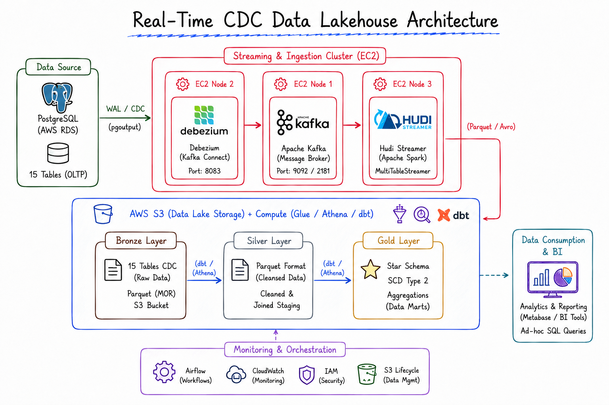

# Real-Time E-Commerce Analytics Lakehouse (CDC & Medallion Architecture)

> **Architected & Implemented by:** Dung Pham  
> **Repository:** [dvdrental_streaming_data](https://github.com/Dungpham0703/dvdrental_streaming_data)  
> **Tech Stack:** AWS RDS PostgreSQL, Debezium Connect, Apache Kafka, Apache Hudi, AWS S3, AWS Glue Data Catalog, dbt (dbt-athena), AWS Athena, Docker, GitHub Actions CI/CD

---

## Architecture Overview



This project delivers an **End-to-End Enterprise Data Lakehouse** that captures real-time Change Data Capture (CDC) events from an operational transactional database (PostgreSQL RDS `dvdrental` schema), streams them into **AWS S3** via **Debezium**, **Kafka**, and **Apache Hudi**, catalogs them in **AWS Glue Data Catalog**, transforms them into a **Star Schema with SCD Type 2** using **dbt-athena**, and exposes business-ready OLAP analytics via **AWS Athena** and BI visualization tools (**Apache Superset / Amazon QuickSight / Power BI**).

---

## 1. Step 1: Business Problem & Requirements

### 1.1 Business Context & Challenges

Operational transactional databases (OLTP) like PostgreSQL (`dvdrental` schema with 15 normalized 3NF tables) are optimized for low-latency row-level writes (INSERT/UPDATE/DELETE). However, relying directly on an OLTP database for analytical queries presents severe business hurdles:

- **System Overhead & Database Locking**: Running complex analytical aggregation queries (e.g., historical revenue by region or customer lifetime value) consumes high CPU/Memory, risking locks and degrading the performance of customer-facing transactions.
- **Loss of Historical State (SCD Problem)**: Overwriting attributes such as customer addresses, store assignments, or staff details erases historical context, rendering past analytical metrics inaccurate.
- **High Reporting Latency**: Traditional batch nightly ETL pipelines fail to deliver the near-real-time business visibility required for agile inventory and customer engagement decisions.

### 1.2 Core Business Requirements & Goals

1. **OLTP-to-OLAP Transformation**: Transform 15 operational 3NF tables into an optimized OLAP Data Lakehouse tailor-made for Data Analysts (DA) and BI engineers to query effortlessly using standard SQL.
2. **Zero-Impact Real-Time Ingestion (CDC)**: Continuously capture and stream change events (`INSERT`, `UPDATE`, `DELETE`) from PostgreSQL without affecting transactional throughput.
3. **Medallion Data Lakehouse Architecture**: Store data on AWS S3 across 3 decoupled tiers:
   - **Bronze Layer (Raw CDC)**: Streaming Hudi Merge-On-Read (MOR) raw event tables.
   - **Silver Layer (Cleansed & SCD Type 2)**: Deduplicated historical dimensions tracking change history over time (`valid_from`, `valid_to`, `is_current`).
   - **Gold Layer (OLAP Star Schema)**: High-performance dimensional models (Fact & Dimension tables).
4. **Slowly Changing Dimensions (SCD Type 2)**: Preserve complete historical state changes (e.g. customer address/email updates) to support accurate Customer 360 analysis.
5. **Automated & Decoupled Infrastructure**: Multi-node Docker Compose setup on AWS EC2, automated via GitHub Actions CI/CD.

---

## 2. Step 2: Data Understanding & Data Modeling

### 2.1 Operational Source Schema (15 OLTP 3NF Tables)

The operational system consists of 15 normalized (3NF) relational tables in PostgreSQL:
`customer`, `rental`, `payment`, `film`, `actor`, `category`, `film_category`, `film_actor`, `inventory`, `store`, `staff`, `address`, `city`, `country`, `language`.

### 2.2 Analytics Data Warehouse Modeling (Star Schema & SCD Type 2)

To optimize query performance for Data Analysts and minimize multi-table join complexity, the 15 3NF tables are modeled into a **Star Schema**:

```
      ┌─────────────────────────┐             ┌─────────────────────────┐
      │      dim_customer       │             │        dim_date         │
      │ ----------------------- │             │ ----------------------- │
      │ (SCD Type 2 History)    │             │ (Time Context)          │
      │ PK: customer_key        │             │ PK: date_key            │
      │ valid_from, valid_to    │             │ day, month, year...     │
      └───────────┬─────────────┘             └─────────────┬───────────┘
                  │ 1:N                                     │ 1:N
                  │           ┌───────────────┐             │
                  └─────────► │  FACT TABLES  │ ◄───────────┘
                              │ ------------- │
                              │ fact_rental   │
                              │ fact_payment  │
                  ┌─────────► │               │ ◄───────────┐
                  │ 1:N       └───────────────┘       1:N   │
                  │                                         │
      ┌───────────┴─────────────┐             ┌─────────────┴───────────┐
      │        dim_film         │             │     dim_store_staff     │
      │ ----------------------- │             │ ----------------------- │
      │ (Movie Details)         │             │ (Location/Staff Info)   │
      │ PK: film_key            │             │ PK: store_key/staff_key │
      │ title, category, rating │             │ address, city, country  │
      └─────────────────────────┘             └─────────────────────────┘
```

### 2.3 Fact & Dimension Definitions

#### Fact Tables (Business Event Transactions)

- **`fact_rental`**: Central transactional fact recording every rental event (`rental_id`, `customer_key`, `film_key`, `store_key`, `staff_key`, `rental_date_key`, `return_date_key`, `rental_duration_days`).
- **`fact_payment`**: Financial metrics table tracking payments (`payment_id`, `customer_key`, `staff_key`, `payment_date_key`, `amount`).

#### Dimension Tables & SCD Type 2 Design

- **`dim_customer` (SCD Type 2)**: Tracks profile updates (address, store assignment, active status, email). When a customer's location or details change, a new record is inserted with a new surrogate key (`customer_key`), updating the previous record's `valid_to` timestamp and setting `is_current = false`. This guarantees 100% accurate historical reporting.
- **`dim_film`**: Rich catalog of movies (`film_id`, `title`, `description`, `release_year`, `rating`, `category_name`, `rental_rate`, `length`).
- **`dim_store_staff`**: Denormalized store hierarchy linking staff members and geographic locations (`store_id`, `staff_id`, `staff_name`, `address`, `city`, `country`).
- **`dim_date`**: Standard date dimension facilitating daily, weekly, monthly, and fiscal trend analyses.

---

## 3. Step 3: Tool Selection & Tech Stack Justification

| Layer / Component           | Tool Selected                               | Why This Tool? (Technical & Architectural Rationale)                                                                                                                              |
| --------------------------- | ------------------------------------------- | --------------------------------------------------------------------------------------------------------------------------------------------------------------------------------- |
| **OLTP Source DB**          | **AWS RDS PostgreSQL**                      | Robust relational database. Enabled with `rds.logical_replication = 1` (`wal_level = logical`) to stream raw WAL change logs without SQL query overhead.                          |
| **CDC Engine**              | **Debezium Connect**                        | Log-based CDC connector that reads PostgreSQL WAL directly. Operates asynchronously with zero query performance penalty on the production database.                               |
| **Streaming Broker**        | **Apache Kafka & Zookeeper**                | High-throughput distributed message broker ensuring fault-tolerant buffering and pub-sub decoupling between CDC and Lakehouse storage layers.                                     |
| **Lakehouse Format**        | **Apache Hudi (MOR)**                       | Open-source lakehouse engine providing ACID transactions on AWS S3. Merge-On-Read (MOR) mode enables sub-minute CDC upserts and deletes via Delta Logs.                           |
| **Data Lake Storage**       | **AWS S3**                                  | Cost-effective, scalable object storage hosting the Medallion Data Lake layers (Bronze, Silver, Gold) with high durability and security.                                          |
| **Data Metastore**          | **AWS Glue Data Catalog**                   | Unified serverless metastore syncing S3 data schemas for immediate discovery and querying by AWS Athena and Apache Spark.                                                         |
| **Data Transformation**     | **dbt (dbt-athena)**                        | Industry standard for modular SQL transformations. Automates lineage, snapshot tracking for SCD Type 2, and data quality testing natively against AWS Athena.                     |
| **Query Engine**            | **AWS Athena**                              | Serverless interactive ANSI SQL engine powered by Trino/Presto. Allows Data Analysts to query S3 Parquet datasets with pay-per-query pricing and zero infrastructure maintenance. |
| **BI & Visualization**      | **Apache Superset / QuickSight / Power BI** | Enables interactive dashboards for executive revenue metrics, customer churn analysis, and rental velocity directly querying Gold tables in Athena.                               |
| **DevOps & Infrastructure** | **AWS EC2, Docker, GitHub Actions**         | Containerized deployment using Docker Compose on EC2 instances, with automated CI/CD pipelines via GitHub Actions.                                                                |

---

## 4. Step 4: Implementation Details

### 4.1 Step 4.1: Database Setup & CDC Configuration

- Enabled logical replication on AWS RDS PostgreSQL (`rds.logical_replication = 1`).
- Initialized the 15 operational tables under the `dvdrental` database schema.
- Configured VPC Security Groups to restrict access between RDS PostgreSQL and the EC2 processing cluster.

### 4.2 Step 4.2: Distributed Ingestion Cluster Setup (AWS EC2 & Docker)

Deployed decoupled ingestion nodes using Docker Compose on AWS EC2:

- **Node 1 (Kafka Broker)**: Runs Zookeeper (Port 2181) and Apache Kafka (Port 9092) for message queuing.
- **Node 2 (Debezium Connect)**: Runs Debezium Connect 2.4 (Port 8083), monitoring PostgreSQL WAL and publishing CDC streams to Kafka topics (`postgres.public.<table_name>`).

Registering the Debezium Postgres connector via REST API:

```bash
curl -X POST -H "Content-Type: application/json" \
  --data @connector_configs/postgres_sources.json \
  http://<EC2_CONNECT_PRIVATE_IP>:8083/connectors
```

### 4.3 Step 4.3: Real-Time Ingestion to S3 Bronze Layer (Apache Hudi Streamer)

`HoodieMultiTableStreamer` consumes raw CDC events from Kafka topics and writes Hudi MOR tables into the **S3 Bronze Layer**:

```bash
/opt/spark/bin/spark-submit \
  --class org.apache.hudi.utilities.streamer.HoodieMultiTableStreamer \
  --packages org.apache.hudi:hudi-spark3.5-bundle_2.12:0.15.0,org.apache.hudi:hudi-utilities-bundle_2.12:0.15.0,org.apache.spark:spark-sql-kafka-0-10_2.12:3.5.0,org.apache.hadoop:hadoop-aws:3.3.4,com.amazonaws:aws-java-sdk-bundle:1.12.261 \
  --config-folder /opt/hudi-configs/tables \
  --base-path-prefix s3a://${S3_BUCKET_NAME}/bronze/ \
  --props file:///tmp/common.properties \
  --source-class org.apache.hudi.utilities.sources.JsonKafkaSource \
  --schemaprovider-class org.apache.hudi.utilities.schema.FilebasedSchemaProvider \
  --table-type MERGE_ON_READ \
  --source-ordering-field __ts_ms
```

### 4.4 Step 4.4: AWS Glue Catalog Sync & dbt-Athena Transformation Pipeline

1. **Cataloging**: AWS Glue Crawlers automatically index `s3://${S3_BUCKET_NAME}/bronze/` tables into the Glue Data Catalog database `dvdrental_bronze`.
2. **dbt Transformation Layers**:
   - **Silver Models (Deduplication & Cleansing)**: dbt models clean raw JSONCDC fields, filter tombstone deletes, and deduplicate state changes using `row_number() over (partition by id order by __ts_ms desc)`.
   - **Silver SCD Type 2 (`dim_customer`)**: dbt snapshots and SQL window functions generate `valid_from`, `valid_to`, and `is_current` columns to track full history.
   - **Gold Models (Star Schema Data Marts)**: Materializes `fact_rental`, `fact_payment`, `dim_film`, `dim_customer`, and `dim_store_staff` as columnar Parquet tables in S3 Gold bucket path.

Executing dbt commands:

```bash
# Install packages & verify connection
dbt deps
dbt debug --target prod

# Run transformation layers & test data quality
dbt run --select tag:silver
dbt run --select tag:gold
dbt test
```

### 4.5 Step 4.5: Analytics Querying & BI Dashboard Layer

Data Analysts execute high-speed ANSI SQL queries in **AWS Athena** over Gold Data Marts:

```sql
-- Analytical Query: Monthly Revenue & Rental Volume by Film Category with Customer History
SELECT
    f.category_name,
    d.year,
    d.month_name,
    COUNT(r.rental_id) AS total_rentals,
    SUM(p.amount) AS total_revenue
FROM gold_db.fact_rental r
JOIN gold_db.fact_payment p ON r.rental_id = p.rental_id
JOIN gold_db.dim_film f ON r.film_key = f.film_key
JOIN gold_db.dim_date d ON r.rental_date_key = d.date_key
GROUP BY f.category_name, d.year, d.month_name
ORDER BY total_revenue DESC;
```

#### BI Visualization Dashboards (Apache Superset / QuickSight / Power BI)

BI Dashboards connect directly to AWS Athena Gold tables to visualize key business KPIs:

1. **Executive Revenue Dashboard**: Track monthly recurring revenue, rental volume, and average payment amount.
2. **Customer 360 & Mobility Analysis**: Monitor customer activity levels, address changes over time (via SCD2), and retention rates.
3. **Film Performance & Inventory Turnover**: Identify top-grossing movie categories, rental duration trends, and stock turnover efficiency.

---

## 5. Step 5: Review, Performance & Future Enhancements

### 5.1 Project Review & Key Accomplishments

- **15 OLTP Tables Successfully Transformed**: Transformed complex 3NF transactional data into a clean, query-ready OLAP Star Schema for Data Analysts.
- **Zero Impact on Production OLTP**: Log-based CDC via Debezium eliminated read locks and query pressure on PostgreSQL RDS.
- **SCD Type 2 Historical Tracking**: Preserved full historical audit trail for customer profile updates without data loss.
- **Sub-Minute Data Latency**: CDC event streaming to S3 Bronze layer completes in near-real-time.
- **Serverless Analytical Accessibility**: Data Analysts query clean Gold Parquet tables in AWS Athena using standard SQL without managing database servers.

### 5.2 Performance & Cost Optimization

- **Snappy-Compressed Parquet Format**: Converting Bronze Hudi tables into Snappy Parquet in the Gold layer reduced S3 storage volume by **~75%** and significantly accelerated Athena query speeds.
- **Partition Pruning**: Fact tables (`fact_rental`, `fact_payment`) are partitioned by `year` and `month`, dramatically reducing data scanned during query execution and lowering Athena per-query cost.
- **Automated Data Quality Checks**: Integrated dbt data tests (`unique`, `not_null`, `relationships`) into the CI pipeline to prevent bad data from reaching downstream BI tools.

### 5.3 Roadmap & Future Enhancements

- [ ] **Infrastructure as Code (IaC)**: Automate EC2, S3, Glue, and Athena provisioning using Terraform or AWS CDK.
- [ ] **Data Lineage & Governance**: Integrate Apache Atlas or OpenMetadata for automated schema governance and visual lineage tracking.
- [ ] **Automated Alerting**: Configure CloudWatch and AWS SNS notifications for streaming lag or dbt test failures.

---

## Author & Contact

- **Author:** Dung Pham
- **GitHub:** [@Dungpham0703](https://github.com/Dungpham0703)
- **Repository:** [dvdrental_streaming_data](https://github.com/Dungpham0703/dvdrental_streaming_data)
